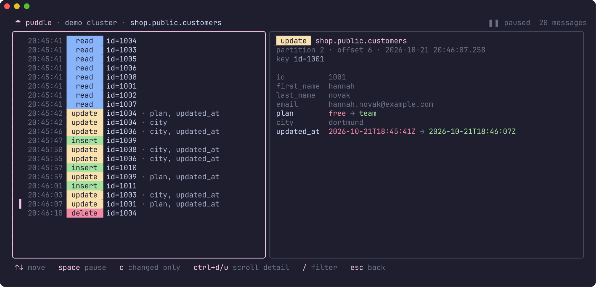

<div align="center">

# ☂ puddle

**watch your kafka and redpanda topics in the terminal.**<br>
debezium change events show up field by field, so you see exactly what changed in your database.

[](https://go.dev)
[](#)
[](LICENSE)



</div>

## why

change data capture is great until you have to debug it. `kcat` and the
console consumer print walls of json, and spotting which column actually
changed in an update means reading two nested objects side by side.

puddle reads the debezium envelope for you. every message gets a coloured
badge (insert, update, delete, snapshot read), the list shows the row key
and which fields changed, and the detail pane lines up before and after so a
change reads like `free → team`. anything that isn't debezium still works,
with json pretty printed and highlighted and plain text shown as is.

## try it

```sh
go install github.com/Dem1241/puddle@latest
puddle --demo
```

`--demo` starts a small in-memory cluster with a pretend shop database
streaming live inserts, updates and deletes, so you can look around without
running a broker.

## use it

```sh
puddle                              # localhost:9092
puddle -b broker1:9092,broker2:9092 # or set PUDDLE_BROKERS / KAFKA_BROKERS
puddle shop.public.orders           # open a topic straight away
puddle --last 1000                  # load more history per partition
```

| key | does |
|:--|:--|
| `↑` `↓` or `j` `k` | move through topics or messages |
| `enter` | open a topic |
| `space` | pause or resume the live stream |
| `c` | show only the fields that changed |
| `ctrl+d` `ctrl+u` | scroll the detail pane |
| `/` | filter topics or messages |
| `esc` | clear the filter, or go back to the topic list |
| `q` | quit |

moving up the list pauses the stream on its own, so the message you are
reading stays put while new ones arrive below.

## what it understands

- debezium json from postgres, mysql and friends, with or without the
  schema wrapper (`schemas.enable` on or off)
- keys with or without a schema, shown as `id=1004`
- tombstones, plain json, plain text and binary values
- topics with any number of partitions, merged into one timeline by
  change time

avro and protobuf aren't decoded yet.

## how it works

puddle uses [franz-go](https://github.com/twmb/franz-go) to talk to the
cluster and [bubble tea](https://github.com/charmbracelet/bubbletea) for the
interface. it reads topics without a consumer group, so it never commits
offsets or touches anyone else's consumers. the demo runs on franz-go's
`kfake`, which also powers the tests.

```sh
go test ./...
golangci-lint run
```

## license

[MIT](LICENSE)
